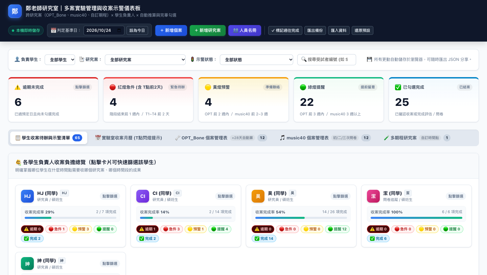

# 鄭老師研究室｜多案實驗管理與收案示警儀表板

> **專為臨床醫學工程／復健科學研究室打造的收案追蹤與示警管理系統。**  
> 目前為純前端、單機／受控環境版本；正式研究資料尚未支援多人即時同步，不可直接部署到公開 GitHub Pages。



---

## 📌 專案特點

1. **零安裝與跨平台**：純靜態 HTML/CSS/JavaScript，不需 Node.js、Python 或任何後端資料庫，點擊即可在任一現代瀏覽器開啟。
2. **多案跨專案集中管控**：
   - 預載 **`OPT_Bone`**（骨科手術前後跨期介入追蹤）。
   - 預載 **`music40`**（音樂輔助訓練三次評估與問卷追蹤）。
   - 支援建立任意多期程自訂實驗案（如 1 個月、3 個月、6 個月等）。
3. **學生負責人收案負擔看板**：
   - 掌握哪位學生在什麼時間點收哪個研究案的成果。
   - 每位學生專屬色彩頭像、即時收案完成率進度條（Progress Bar）、逾期／急件／預警徽章。
   - 點擊卡片即可快速篩選個人專案待辦清單。
4. **自訂追蹤時間點設計器（Milestone Builder）**：
   - 每個研究案可自由增減、排序時間點，自訂推算天數（距開始日 `+N天`）、節點負責人與示警等級。
   - 內建「標準三期 (1M/3M/6M)」、「雙階段+28天介入」、「密集月追蹤」、「週追蹤」等快速範本。
   - 隨時編輯研究案設定，系統自動為既有受試者補齊新階段排程。
5. **實驗室成員名冊管理（防呆下拉選單）**：
   - 集中管理實驗室研究員、碩士班研究生代號與稱謂。
   - 全域表單整合 Autocomplete 自動補全，避免打錯字或縮寫不一致。
6. **專屬臨床示警規則**：
   - **OPT_Bone 自動 +28 天推算**：輸入各階段開始日期時，系統自動推算結束日為 `開始日 + 28 天`，亦保留手動彈性微調。
   - **T1 ～ T4 重大收案急件前 2 天閃爍**：紅燈高頻呼吸閃爍（`@keyframes pulse-red`），月曆當日方格加粗紅框醒目提示。
   - **music40 問卷日期彈性排程**：初／二／三次問卷日期可任意自訂，或一鍵「同評估日」快速帶入。
   - **逾期自動判定**：早於基準日且未完成者自動置頂標記為「逾期未完成」，完成狀態只能由使用者逐筆人工確認。
7. **資料安全與備份**：
   - 採用瀏覽器 `localStorage` 即時自動儲存，重整或關閉瀏覽器資料不遺失。
   - 頂部支援「匯出備份（JSON）」與「匯入資料」，方便跨裝置或與實驗室同學同步進度。

---

## 🚀 快速開始

### 方式一：直接在本機開啟
在 Finder 雙擊或將 [index.html](index.html) 拖入 Chrome、Safari、Edge 等任一瀏覽器即可開始使用。

### 方式二：建立公開 Demo（僅限假資料）
本專案目前沒有登入、權限、多人同步或伺服器端衝突控制。若部署到 GitHub Pages，只能使用不含研究資料的 DEMO fixture；正式研究資料不可直接放在公開 GitHub Pages。
如需展示介面，請先移除真實 `index.html`／`initial-data.json` 中的研究資料，改用 `DEMO-001` 等假資料，再依 GitHub Pages 官方流程部署。正式資料版本須等 Phase 0 權限確認與多人後端 PoC 完成後，部署至經核准且具存取控制的環境。

---

## 📂 檔案清單

```text
zheng-lab-tracker/
├── index.html          # 目前前端 UI 與研究流程（重構中的 legacy entry）
├── initial-data.json   # 開發／遷移 fixture，不是正式公開資料
├── api/                # Vercel API：資料、匯入、還原、備份與健康檢查
├── src/lib/            # 資料存取、Supabase Auth 與共用 schema 驗證模組
├── supabase/           # PostgreSQL／角色／revision／稽核 migration
├── vercel.json         # Vercel Functions 與備份排程
├── .env.example        # 後端環境變數範本
├── preview.png         # 儀表板高解析度預覽截圖
├── README.md           # 專案首頁說明與操作指南
└── .gitignore          # 排除 Mac .DS_Store 等垃圾檔案
```

---

## 🚦 示警燈號判定規則說明

| 燈號狀態 | 判斷條件 | 說明與建議動作 |
| :---: | :--- | :--- |
| **⚠️ 逾期未完成** | 早於判定基準日，且尚未勾選完成 | 已過預定收案日，需儘速聯繫補測或確認受試者狀況。 |
| **🔴 重大急件 (RED_T)** | `OPT_Bone` T1~T4 或自訂重大節點，距到期日 **≤ 2 天** | 高頻閃爍紅燈，月曆標註粗紅外框，提醒立即確認收案場地與儀器。 |
| **🔴 紅燈** | 距離預定收案日 **≤ 7 天**（1 週內） | 緊急待辦，提醒受試者訪視時間。 |
| **🟡 黃燈** | 距離預定收案日 **8 ～ 21 天**（2～3 週內） | 準備聯絡，確認介入進度與追蹤排程。 |
| **🟢 綠燈** | 距離預定收案日 **> 21 天**（3 週以上） | 提前留意，觀察排程分布。 |
| **✅ 已完成** | 已手動點擊切換為完成 | 評估／問卷已收案完畢，計入完成率。 |

---

## 💾 資料備份與跨成員協作

- **自動本機持久化**：每次點擊完成、新增受試者或修改日期，右上角即刻更新至 `localStorage`。
- **人工備份／轉移**：
  1. 使用者點擊頂部 **「匯出備份」**，瀏覽器下載帶有時間戳的 JSON 備份檔。
  2. 其他使用者可點擊 **「匯入資料」**；系統會先驗證格式、顯示摘要並要求確認，取消不會改變目前資料。
  3. 匯入覆蓋前會先建立匯入前快照；目前仍不是即時共用資料庫，也沒有自動雲端備份。
  4. `initial-data.json` 僅供開發／遷移 fixture，不提供一般使用者一鍵還原。

> **跨電腦同步說明**：目前版本的 `localStorage` 只存在於單一瀏覽器／裝置，JSON 匯出／匯入是人工同步機制，並非即時共用資料庫。若要多人同時編輯與自動備份，下一階段應接上具身分驗證、版本／衝突處理及定期備份的共用後端；不建議直接把 Google Drive API 金鑰放在公開的靜態頁面。

---

## 🧱 Vercel 後端化狀態

本專案已開始從單一靜態頁面升級為可部署至 Vercel 的前後端架構：

- `api/health.js`：部署健康檢查。
- `api/data.js`：登入後的共用資料讀取與 revision 衝突阻擋寫入。
- `api/import.js`、`api/restore.js`：管理權限匯入／還原 API。
- `api/backup.js`、`api/backups.js`：每日備份與備份清單 API。
- `supabase/migrations/001_lab_state.sql`：角色、主資料、revision、備份與稽核資料表及交易函式。
- `vercel.json`：API Function 與每日備份排程設定。
- `.env.example`：Supabase 與 Vercel 環境變數範本。

目前後端已完成 Supabase Auth、RLS、共用資料、revision 衝突阻擋、requestId 冪等、稽核、匯入前快照、還原前快照、checksum 與備份健康記錄的 PoC；仍不代表正式多人系統已上線。正式啟用前必須在核准的 Supabase 專案執行 migration，設定 Vercel 環境變數、email 白名單與管理者帳號，並完成兩帳號衝突測試、備份失敗測試、checksum 還原拒絕測試及實際回復演練。若未設定後端，現有網頁仍以受控環境的 localStorage 模式運作。

### 後端啟用順序

1. 在你的 Supabase 測試專案執行 `supabase/migrations/001_lab_state.sql`；目前只使用假資料，不匯入正式研究資料。
2. 複製 `.env.example` 為 `.env.local`，填入測試專案 URL 與 anon public key；可執行 `npm run check:env` 檢查格式，工具不會輸出 key 內容。
3. 若測試管理員 API，再把 `SUPABASE_SERVICE_ROLE_KEY` 放入本機 `.env.local` 或 Vercel Server-only Environment Variables，絕不放入前端或提交 Git。
4. 建立 `lab_profiles` 管理者、備援管理者與研究人員帳號。
5. 先以 `/api/health`、`/api/data`、`/api/backup` 測試資料服務；前端已支援受控 runtime 設定 `window.__ZHENG_LAB_BACKEND__ = { enabled: true, apiBase: '/api', token: '<short-lived-user-token>' }` 後切換至共用 API。Token 不得寫入 Git、HTML 原始碼或公開環境變數。正式前端登入需在部署頁面以受控 runtime 設定 `window.__ZHENG_LAB_AUTH__ = { supabaseUrl: 'https://<project>.supabase.co', anonKey: '<public-anon-key>' }`；anon key 可公開，但密碼、access token 與 service role key 不可放入前端。登入後 session 會儲存在瀏覽器並在過期前自動 refresh。
6. 第二階段可先執行 `npm run supabase:seed:demo` 寫入完全匿名化的 `DEMO-001`～`DEMO-003`；此命令會將 `lab_state` 重設為 revision 1，僅限個人測試專案使用。
7. 在 Supabase Authentication → Users 建立測試使用者（建議開啟 Auto Confirm），再於 `.env.local` 設定 `DEMO_AUTH_EMAIL` 與 `DEMO_AUTH_ROLE`，執行 `npm run supabase:assign:profile` 建立 `lab_profiles` 角色；前端才可用短期 user token 啟用 API 模式。以假資料完成 B01–B14，未完成權限與備份演練前不得匯入正式研究資料。

## 🧪 上線前演練指令

完成 Vercel Production 部署與第二個測試帳號後，可在本機以環境變數執行：

```bash
# 兩帳號同 revision 衝突測試
ZHENG_API_BASE=https://<project>.vercel.app/api \
DEMO_AUTH_PASSWORD='帳號一密碼' \
DEMO_AUTH_EMAIL_2='second@example.edu' \
DEMO_AUTH_PASSWORD_2='帳號二密碼' \
npm run test:live:concurrency

# Vercel health 與備份端點驗證
CRON_SECRET='與 Vercel 相同的 secret' \
npm run verify:vercel -- https://<project>.vercel.app

# 備份／checksum／還原前快照演練（明確設定 YES 才會執行）
RUN_RESTORE_REHEARSAL=YES \
ZHENG_API_BASE=https://<project>.vercel.app/api \
DEMO_ADMIN_ACCESS_TOKEN='短期 admin access token' \
CRON_SECRET='與 Vercel 相同的 secret' \
npm run test:live:restore
```

演練只可使用匿名 Demo 資料；`test-live:restore` 會提高 revision 並還原測試備份，不得在尚未建立快照與核准窗口前對正式研究資料執行。

正式部署前的檢查包括：

```bash
npm run check
npm test
npm run test:contracts
npm run check:fixtures
```

## 📜 授權與研究室標註

- **研究主持人**：鄭老師研究室
- **授權協議**：MIT License
